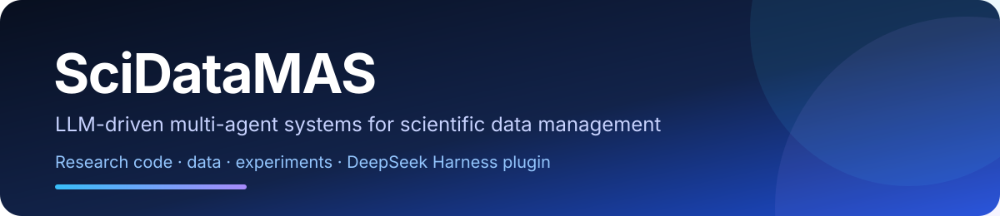
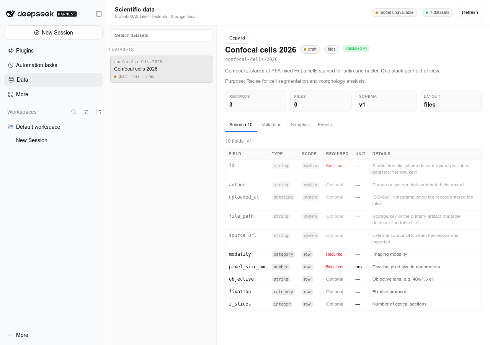
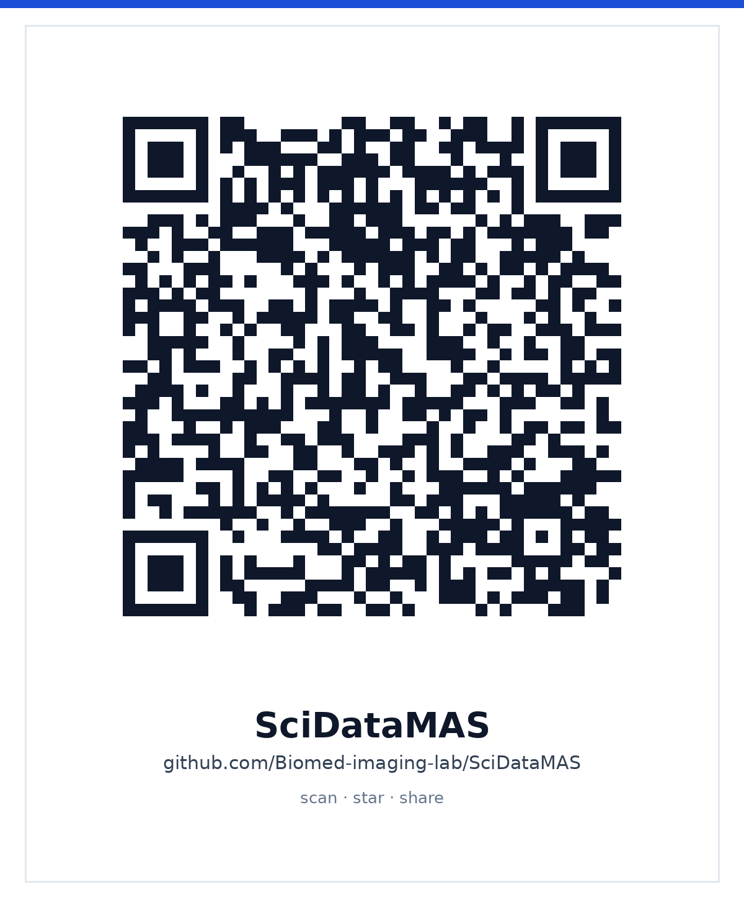

<div align="center">



### LLM-driven multi-agent systems for scientific data management

**Research code · data · experiments · DeepSeek Harness plugin**

[](LICENSE)
[](research/requirements.txt)
[](plugin/)
[](plugin/test)
[](https://github.com/Biomed-imaging-lab/SciDataMAS/stargazers)

[Research](#research-code-and-experiments) · [Experiments](#experiments-at-a-glance) · [Plugin](#deepseek-harness-plugin) · [Cite](#citation) · [Star & share](#star-and-share)

</div>

---

**SciDataMAS** turns heterogeneous scientific records into AI-ready data. It
generates an adaptive metadata schema, validates that schema through simulated
peer review, stages ingestion so missing fields block a commit instead of being
guessed, retrieves files with natural-language queries, and keeps every change
auditable.

This repository keeps two deliverables together so a reader can move from the
paper to a running system:

| Part | What it is | Entry point |
|---|---|---|
| **`research/`** | The multi-agent system, demos, the metadata-curation experiment harness, and the curated metadata tables used as ground truth. | [`research/README.md`](research/README.md) |
| **`plugin/`** | **SciDataMAS for DeepSeek Harness** — the same lake as 11 agent-facing tools plus a native **Data** Web panel. | [`plugin/README.md`](plugin/README.md) |

> **Why one repository?** A paper repository usually stops at code, and a
> plugin repository usually stops at an install command. Putting them side by
> side makes the claim reproducible end to end: the same schema logic that the
> experiments evaluate is the logic a DSH user runs locally.

## DeepSeek Harness plugin

The plugin is a research prototype, currently at version `0.1.0` and in user
testing. It is not a production data-management system and does not replace a
LIMS, an ELN or an institutional repository.

<p align="center">
  
</p>

### Install

Requirements: DeepSeek Harness `0.2.2-rc.1` (or a compatible `0.2.x`), Node.js
20+, and a configured DSH model route.

```bash
git clone https://github.com/Biomed-imaging-lab/SciDataMAS.git
cd SciDataMAS
dsh plugin --profile web add file:$PWD/plugin
```

No build step is required: the package is plain ESM and the client bundle is
authored. The **Data** panel appears in the DSH sidebar and can be docked next
to the chat.

### What it adds

- **Adaptive schemas** — `scidatamas_create_dataset` and the DAG-augmented
  `scidatamas_create_dataset_dag`.
- **Debate validation** — `scidatamas_validate_schema` asks what real reusers
  would ask, then exposes the gaps.
- **Staged human-in-the-loop ingestion** — `scidatamas_add_data` +
  `scidatamas_commit_add`: nothing is copied while required fields are missing.
- **Natural-language retrieval** — `scidatamas_get_data`, with a safe JSON
  filter and resolved artifact paths.
- **Zenodo / URL import** — `scidatamas_import_external`.
- **Diagnostics** — `scidatamas_status`, `scidatamas_list_datasets`,
  `scidatamas_inspect_dataset`.
- **Read-only Data panel** — catalog, schema, validation report, samples,
  metadata content, events and artifact links.

Docs: [user guide](plugin/docs/USER-GUIDE.md) ·
[tools](plugin/docs/TOOLS.md) ·
[architecture](plugin/docs/ARCHITECTURE.md) ·
[user-testing protocol](plugin/docs/USER-TESTING.md) ·
[changelog](plugin/CHANGELOG.md).

## Research code and experiments

The research half is a Python 3.10 application with a Streamlit GUI and a
separate, deterministic experiment harness.

```bash
cd research
python3 -m venv .venv
source .venv/bin/activate
pip install -r requirements.txt
cp src/.env.example src/.env        # add your model keys
cd src && streamlit run main.py
```

Start with [`research/README.md`](research/README.md) for the app, the six
demos, the storage backends and the reported AAAI-26 results. The demos are in
[`research/demos/`](research/demos).

### Experiments at a glance

The 2026 paper studies four tasks: representation analysis, generation from a
free-text query, generation from papers/Zenodo records, and schema
harmonization. The harness is in
[`research/experiments/`](research/experiments/README.md).

| Study | Code | Included artifacts |
|---|---|---|
| Generation from a query (`m1`–`m5`, DAG / DSL-DAG) | [`field_recovery_eval/`](research/experiments/knn_evaluation/field_recovery_eval) · [`generators/`](research/experiments/knn_evaluation/generators) | 18 blind queries, 324 generated schemas, recall results |
| Debate-driven completeness | [`metadata_completeness_eval/`](research/experiments/knn_evaluation/metadata_completeness_eval) | 100 probing records, 50 per-target summaries |
| Representation analysis | [`eval/`](research/experiments/knn_evaluation/eval) · [`ipynb_publ_analysis/`](research/experiments/knn_evaluation/ipynb_publ_analysis) | clustering, self-repeatness, variability, paper tables/figures |
| Metadata ground truth / harmonization inputs | [`rag_curator/`](research/rag_curator) | 18 approved tables, 85 extracted FAIRsharing records |

A one-command orientation:

```bash
cd research/experiments/knn_evaluation/data && python prepare_data.py
```

Then follow [`research/experiments/README.md`](research/experiments/README.md)
for the stage-by-stage commands.

## Data and reproducibility

- The two large synthetic metadata tables are stored **gzipped**
  (`m1`: 0.9 MB, `m4`: 2.4 MB; 87 MB uncompressed). Run
  [`prepare_data.py`](research/experiments/knn_evaluation/data/prepare_data.py)
  once to restore the `.csv` files. Checksums and column descriptions are in
  [`data/README.md`](research/experiments/knn_evaluation/data/README.md).
- The 513 MB raw LLM probing cache (13,462 JSON files) is intentionally
  omitted; it is regenerable and not needed to inspect the published
  summaries. See [what is omitted](research/experiments/README.md#what-is-intentionally-omitted).
- No API keys or `.env` files are tracked. Use the
  [`.env.example`](research/src/.env.example) files.
- The plugin snapshot is documented in [`plugin/UPSTREAM.md`](plugin/UPSTREAM.md).

## Citation

If you use this repository, please cite the software and the papers below.
GitHub can also read [`CITATION.cff`](CITATION.cff).

```bibtex
@inproceedings{sachuk2026scidatamas,
  title     = {SciDataMAS: LLM-Driven MAS for Scientific Data Management (Student Abstract)},
  author    = {Sachuk, Alexander and Chukanov, Vyacheslav and Pchitskaya, Ekaterina},
  booktitle = {AAAI-26 Student Abstract},
  year      = {2026}
}

@misc{sachuk2026metadata,
  title  = {LLM-Based Metadata Curation for AI-Ready Science:
            Generation, Harmonization, and Debate-Driven Quality Estimation},
  author = {Sachuk, Alexander and Sivoshenko, Alexander and Zajceva, Lada
            and Chukanov, Vyacheslav and Pchitskaya, Ekaterina},
  year   = {2026},
  note   = {Manuscript}
}
```

The plugin has its own citation metadata:
[`plugin/CITATION.cff`](plugin/CITATION.cff).

## Star and share

<p align="center">
  
  <br>
  <sub>Scan to open the repository · star it · share it</sub>
</p>

- [⭐ Star the repository](https://github.com/Biomed-imaging-lab/SciDataMAS/stargazers)
- [🍴 Fork it](https://github.com/Biomed-imaging-lab/SciDataMAS/fork)
- [Share on X](https://twitter.com/intent/tweet?text=SciDataMAS%20%E2%80%94%20LLM-driven%20scientific%20data%20management%20with%20a%20DeepSeek%20Harness%20plugin&url=https://github.com/Biomed-imaging-lab/SciDataMAS)
- [Share on LinkedIn](https://www.linkedin.com/sharing/share-offsite/?url=https://github.com/Biomed-imaging-lab/SciDataMAS)
- [Share on Telegram](https://t.me/share/url?url=https://github.com/Biomed-imaging-lab/SciDataMAS&text=SciDataMAS%20%E2%80%94%20LLM-driven%20scientific%20data%20management)

If you need to print **before** the branch is merged, use
[`docs/assets/qr-branch.png`](docs/assets/qr-branch.png); it already points
to the `repo-adaptation` preview.

Ready-to-post blurbs (English and Russian) and a plugin-specific QR code are in
[`docs/SHARE.md`](docs/SHARE.md).

## Licence

Code is released under the [MIT licence](LICENSE). Metadata standards bundled
under `research/rag_curator/` remain under their original licences. The plugin
keeps its own [MIT licence](plugin/LICENSE).
