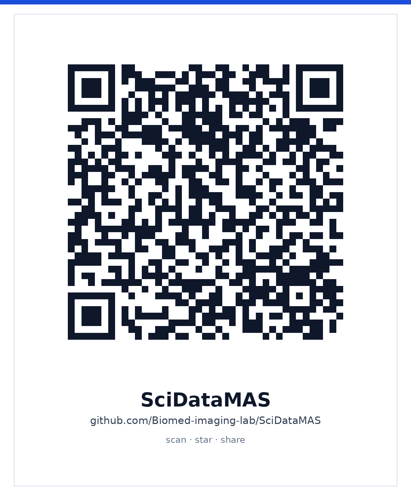

<div align="center">


### LLM-мультиагентные системы для управления научными данными

**Код · данные · эксперименты · плагин для DeepSeek Harness**

[English](README.md) · **Русский**

[](LICENSE)
[](research/requirements.txt)
[](plugin/)

</div>

---

**SciDataMAS** превращает разнородные научные записи в данные, готовые к
машинной обработке: генерирует адаптивную схему метаданных, проверяет её
имитацией рецензирования, проводит поэтапное добавление данных (пока не
заполнены обязательные поля, коммит блокируется), ищет файлы запросами на
естественном языке и хранит аудит каждого изменения.

В репозитории две части:

| Часть | Что это | С чего начать |
|---|---|---|
| **`research/`** | Мультиагентная система, демо, экспериментальный стенд и выверенные таблицы метаданных. | [`research/README.md`](research/README.md) |
| **`plugin/`** | **SciDataMAS для DeepSeek Harness** — те же возможности в виде 11 инструментов агента и нативной панели **Data**. | [`plugin/README.md`](plugin/README.md) |

## Быстрый старт

### Плагин DSH

Нужны DeepSeek Harness `0.2.2-rc.1` (или совместимый `0.2.x`) и Node.js 20+.

```bash
git clone https://github.com/Biomed-imaging-lab/SciDataMAS.git
cd SciDataMAS
dsh plugin --profile web add file:$PWD/plugin
```

Панель **Data** появится в боковой панели DSH; её можно закрепить рядом с
чатом. Документация: [руководство](plugin/docs/USER-GUIDE.md) ·
[инструменты](plugin/docs/TOOLS.md) · [архитектура](plugin/docs/ARCHITECTURE.md).

### Исследовательский код

```bash
cd research
python3 -m venv .venv
source .venv/bin/activate
pip install -r requirements.txt
cp src/.env.example src/.env        # добавьте ключи моделей
cd src && streamlit run main.py
```

Демо — в [`research/demos/`](research/demos). Эксперименты и их данные —
в [`research/experiments/README.md`](research/experiments/README.md).

## Данные и воспроизводимость

- Две большие таблицы синтетических метаданных хранятся в gzip
  (`m1`: 0.9 МБ, `m4`: 2.4 МБ вместо 87 МБ). Перед запуском экспериментов
  выполните [`prepare_data.py`](research/experiments/knn_evaluation/data/prepare_data.py).
- Сырой кэш LLM-опроса (513 МБ, 13 462 JSON) намеренно исключён: он
  восстанавливается запуском и не нужен для проверки опубликованных сводок.
- API-ключи и `.env` в репозиторий не попадают; используйте
  [`.env.example`](research/src/.env.example).

## Цитирование

Используйте [`CITATION.cff`](CITATION.cff) и BibTeX в
[английском README](README.md#citation). У плагина свой
[`CITATION.cff`](plugin/CITATION.cff).

## QR и репост

<p align="center">
  
  <br>
  <sub>Наведите камеру, чтобы открыть репозиторий, поставить звезду и поделиться</sub>
</p>

Готовые тексты для поста и QR на папку плагина — в
[`docs/SHARE.md`](docs/SHARE.md). Лицензия кода — [MIT](LICENSE).
