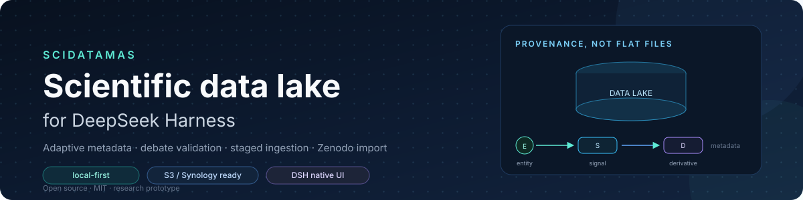
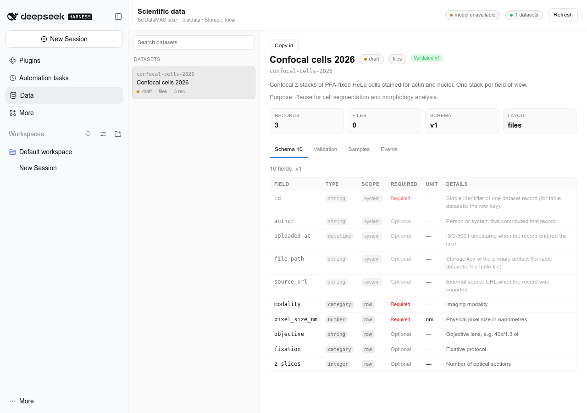
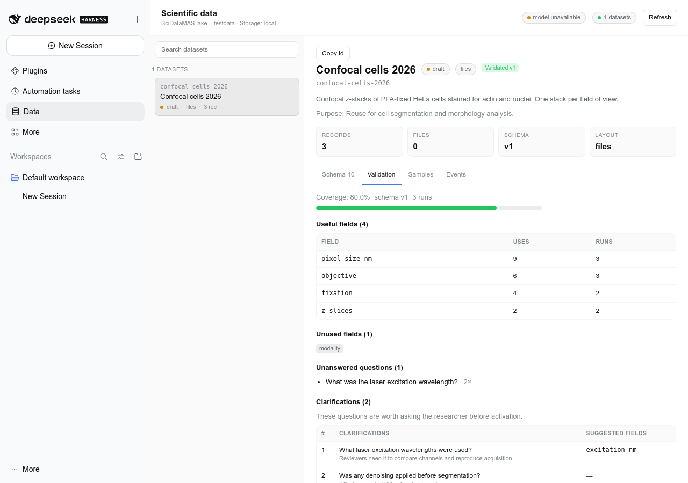
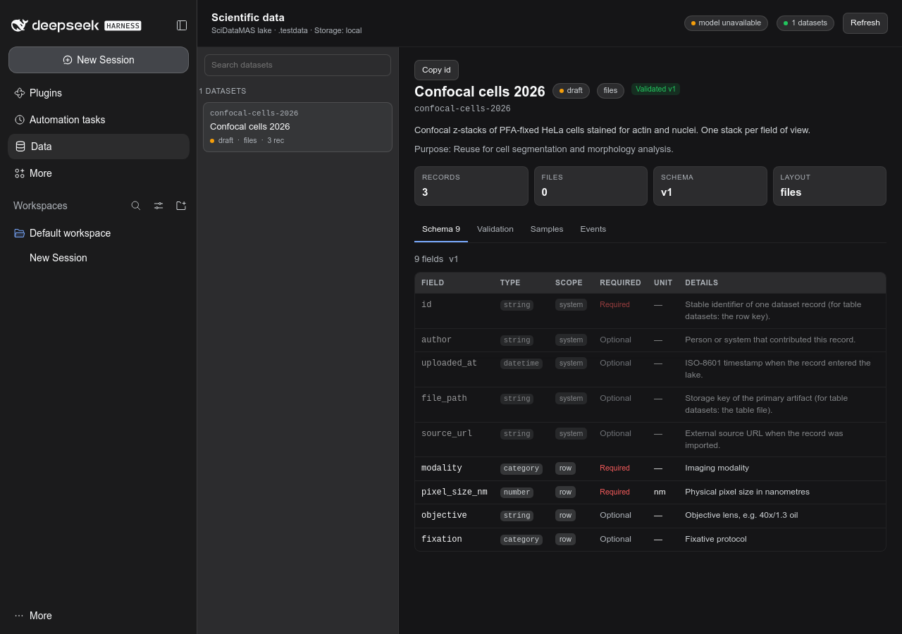
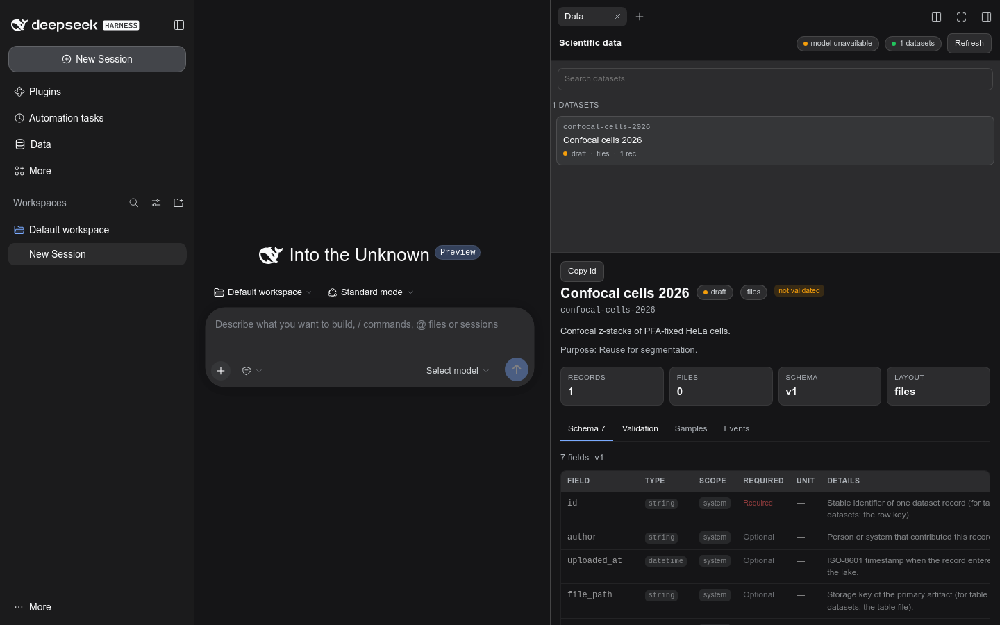
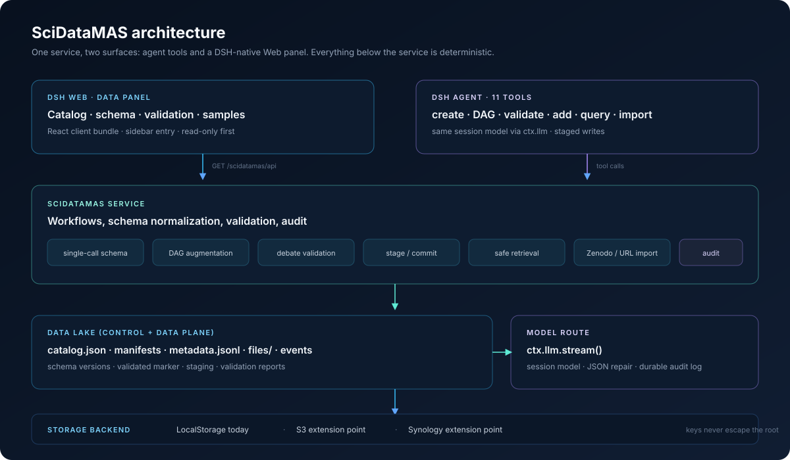

<div align="center">



# SciDataMAS for DeepSeek Harness

**A scientific data lake inside DSH: adaptive metadata, debate-based schema validation, staged ingestion, natural-language retrieval, and a native Web panel.**

**English** · [Русский](README.ru.md) · [中文](README.zh.md)

[](CHANGELOG.md)
[](LICENSE)
[](https://github.com/deepseek-ai/deepseek-harness)
[](test/)
[](docs/USER-TESTING.md)
[](#documentation)

</div>

---

SciDataMAS turns a DSH session into a small, auditable scientific data lake. The agent creates datasets with generated metadata schemas, validates those schemas through simulated peer review, stages new data before committing it, retrieves files through natural-language queries, and imports published datasets from Zenodo or a direct URL. The same lake is visible in a DSH-native **Data** panel.

It is a research prototype, currently in **user testing**. It is not a production data-management system and it does not replace a LIMS, an ELN, or an institutional repository.

> **Testing this build?** Start with the [user guide](docs/USER-GUIDE.md) and the [user-testing protocol](docs/USER-TESTING.md).

> Built on ideas from the SciDataMAS line of work: provenance-based data-lake organization, single-call and DAG-augmented metadata generation, and debate-driven completeness estimation ([Biomed-imaging-lab/SciDataMAS](https://github.com/Biomed-imaging-lab/SciDataMAS)).

## Why

Scientific datasets are usually stored as files with a short README. The metadata that makes them reusable — sample preparation, acquisition parameters, units, derived artifacts, licensing — is missing, inconsistent, or impossible to add retroactively. SciDataMAS makes the metadata schema a first-class object and keeps every change auditable:

- **Adaptive schemas** instead of one fixed template for every experiment.
- **Provenance-aware rich mode** for multi-step laboratory pipelines.
- **Debate validation** that asks what real reusers would ask, then exposes the gaps.
- **Human-in-the-loop ingestion** where missing fields block the commit instead of being guessed.
- **Local-first storage** behind a seam that can grow into S3 and Synology backends.

## What you get

| Action | Tool | What it does |
|---|---|---|
| Create a dataset with a compact schema | `scidatamas_create_dataset` | One model call generates metadata fields from a description and inspected example files. Reserved fields `id`, `author`, `uploaded_at`, `file_path`, `source_url` are added automatically. |
| Create a dataset with rich metadata | `scidatamas_create_dataset_dag` | Designs an experimental provenance DAG (`entity` / `signal` / `derivative`), validates its topology, generates per-node fields, and merges them into one flat schema. |
| Validate a schema | `scidatamas_validate_schema` | Three independent debate runs by default: scenario → reviewer roles → questions → owner answers → useful fields, unanswered questions, and clarifications. |
| Refine and activate | `scidatamas_update_dataset` | Clarify description/purpose, add fields, change status. A schema change invalidates the validated marker. |
| Add data by text and layout | `scidatamas_add_data` + `scidatamas_commit_add` | Inspects files, fills metadata, stages the proposal; commits only after required fields are present. |
| Retrieve data by description | `scidatamas_get_data` | Selects a dataset, builds a safe JSON filter, returns metadata rows and resolved file paths. No SQL is executed. |
| Import from an external source | `scidatamas_import_external` | Zenodo record/DOI or direct URL: analyze, download to staging, inspect, create/annotate a dataset, map record metadata, and commit. |
| Browse the lake | **Data** Web panel | DSH-native sidebar entry with catalog, schema, validation, samples, metadata content, events, and artifact links. Read-only in this version. |
| Diagnostics | `scidatamas_status`, `scidatamas_list_datasets`, `scidatamas_inspect_dataset` | Storage root, model availability, dataset inventory, and per-dataset details. |

The plugin also adds a SciDataMAS section to the agent's system prompt so the model follows the staging/validation discipline instead of guessing.

## Screenshots

<p align="center">
  
  
</p>

<p align="center">
  
</p>

<p align="center"><sub>The panel follows DSH theme tokens, including system dark mode.</sub></p>

<p align="center">
  
</p>

<p align="center"><sub>Chat and Data side by side. Use <strong>Open beside chat</strong> in the Data panel header; the panel docks into the right sidebar.</sub></p>

The **Data** panel is part of the DSH Web GUI, not a separate window. It uses the same profile, the same lake, and the same owner authentication as the rest of the GUI. The **Open beside chat** button switches the main column back to the conversation and opens the same view in the right sidebar, so chat and data stay visible together.

## Architecture



Two surfaces share one service:

- **Agent tools** — 11 model-facing tools for creation, validation, ingestion, retrieval, and import.
- **Web panel** — a React client bundle registered into DSH's `sidebar.panellist` and `main` slots; it talks to a read-only HTTP API.

Below the service, everything is deterministic: schema normalization, DAG validation, staged commits, safe JSON filters, path containment, limits, and audit logs. The model is used where semantic judgment is needed, not for writes.

See [docs/ARCHITECTURE.md](docs/ARCHITECTURE.md) for the full design and extension points.

## Quick start

### Requirements

- DeepSeek Harness `0.2.2-rc.1` (or a compatible `0.2.x`).
- Node.js 20+.
- A configured DSH model route (the plugin uses the session model via `ctx.llm`).
- Optional: `pnpm` if you install through the plugin manager.

### Install as a bundle

```bash
dsh plugin --profile web add file:$PWD
```

### Install manually (no build step)

The package is plain ESM and the client bundle is authored, so no build is required. Make the package visible to the profile and add one row:

```bash
mkdir -p "$DSH_HOME/profiles/web/node_modules"
ln -sfn "$PWD" \
  "$DSH_HOME/profiles/web/node_modules/scidatamas-dsh-plugin"
```

```yaml
# $DSH_HOME/profiles/web/cordis.patch.yml
- insert:
    - id: scidatamas
      name: scidatamas-dsh-plugin
      config:
        root: /home/alex/data/scidatamas
```

If `dsh` is not on PATH (common with npx/desktop setups) or `pnpm` is missing, use [scripts/install-local.sh](scripts/install-local.sh); it links the package, edits the profile patch safely, and creates the lake root.

Restart the profile and ask the agent to run `scidatamas_status`. The **Data** entry appears in the sidebar.

### Minimal configuration

```yaml
- id: scidatamas
  config:
    root: /home/alex/data/scidatamas
    author: A. Sachuk
    # provider/model are optional: by default the session model is used
    maxSchemaFields: 200
    maxDagNodes: 24
    debateRuns: 3
    maxFileBytes: 536870912
    maxDownloadBytes: 2147483648
    allowNetwork: true
    allowPrivateHosts: false
    logLlmCalls: true
    storageDriver: local
```

The lake root can be absolute or relative to the process working directory. For real data, use a dedicated directory outside the repository.

### First five minutes

1. **Create a draft**

   > Create a dataset `confocal_cells_2026` from `/data/exp1`. Description: confocal z-stacks of PFA-fixed HeLa cells, 40×, intended for segmentation. Use the compact schema and show me the result.

2. **Inspect the schema**

   > Inspect `confocal_cells_2026` and explain what each field is for.

3. **Validate it**

   > Run a three-run debate validation and list the questions the schema cannot answer.

4. **Refine and activate**

   > Add `pixel_size_nm`, `objective`, and `fixation`; then set status to active.

5. **Add data**

   > Add `/data/exp2`, but show me the staged metadata before committing. Note: 4% PFA, 40×/1.3 oil, pixel size 100 nm.

6. **Commit after review**

   > Commit the stage with those values. Keep the dataset active.

7. **Retrieve**

   > Find all stacks with pixel size below 150 nm and show me the file paths.

8. **Import from Zenodo**

   > Analyze Zenodo record 5512749. Then import only `**/*.tif`, at most 20 files.

## How it works

### Single-call schema

One model call receives the description, purpose, and a dossier of inspected files: formats, sizes, image dimensions, table headers, JSON shape, and text excerpts. It returns a compact schema. The result is normalized: snake_case names, allowed types, deduplicated fields, a field limit, and reserved organizational fields.

### DAG-augmented schema

For multi-step experiments the plugin first designs a provenance DAG:

- `entity` — a physical object or sample;
- `signal` — digital data captured from an entity;
- `derivative` — digital data computed from signals or other derivatives;
- edges: `preparation` (entity → entity), `capture` (entity → signal), `program` (signal/derivative → derivative).

The DAG is checked for unique ids, legal transitions, acyclicity, and a node limit. Then fields are generated per node and merged, with `node_id` / `node_description` attached. This produces more fields than a flat schema and is better suited to automated annotation; it also produces more fields than every reuse needs.

### Debate validation

Each run invents a concrete experiment from the description and purpose, creates independent reviewer roles, lets them ask the owner questions, and checks which questions the exact schema can answer. Fields that answer questions receive a use; unanswered questions become clarifications and suggested fields. The schema is **not** changed automatically — the researcher decides what to add. The report is stored under `datasets/<id>/validation/latest.json`.

### Staged ingestion

Adding data is two-phase:

1. **Stage** — inspect each file, fill the schema from evidence and the researcher's note, apply explicit values last. If required fields are missing, the stage is returned and no files are copied.
2. **Commit** — strict validation of every record, then copy artifacts and write metadata. One invalid record aborts the whole commit.

This is what makes "the agent could not annotate something, so the user clarifies in text" safe: the clarification becomes an override on a staged object, not a silent guess in the lake.

### Retrieval

The planner selects a dataset and emits a JSON filter, for example:

```json
{"and": [
  {"field": "modality", "op": "eq", "value": "confocal"},
  {"field": "pixel_size_nm", "op": "lt", "value": 150}
]}
```

Supported operators: `eq`, `ne`, `gt`, `gte`, `lt`, `lte`, `in`, `contains`, `starts_with`, `ends_with`, `exists`, `between`, `and`, `or`, `not`. No SQL is generated or executed. A lexical fallback keeps retrieval usable if the model plan fails.

### Tabular data

For `layout: "table"`, the table stays the canonical artifact; the schema describes columns, and row-level metadata is a sidecar keyed by the row key. `get_data` merges table columns and sidecar rows. This avoids duplicating a CSV as a JSON blob and keeps filters working on both layers. Adding **new rows** to an existing table is not supported yet — the current version annotates existing rows.

### External import

Zenodo records are read through the API (`/api/records/<id>`); file bytes go to `_imports/<id>`, are inspected, and only then become a dataset. Record metadata (DOI, license, creators, publication date) is mapped onto the schema, and the source URL is stored on every record. Direct HTTP(S) file URLs use the same staging pipeline. Private hosts are blocked unless `allowPrivateHosts: true`.

## Documentation

| Document | English | Русский | 中文 |
|---|---|---|---|
| User guide | [USER-GUIDE.md](docs/USER-GUIDE.md) | [USER-GUIDE.ru.md](docs/USER-GUIDE.ru.md) | [USER-GUIDE.zh.md](docs/USER-GUIDE.zh.md) |
| User-testing protocol | [USER-TESTING.md](docs/USER-TESTING.md) | [USER-TESTING.ru.md](docs/USER-TESTING.ru.md) | [USER-TESTING.zh.md](docs/USER-TESTING.zh.md) |
| Tool reference | [TOOLS.md](docs/TOOLS.md) | [TOOLS.ru.md](docs/TOOLS.ru.md) | — |
| Architecture | [ARCHITECTURE.md](docs/ARCHITECTURE.md) | [ARCHITECTURE.ru.md](docs/ARCHITECTURE.ru.md) | — |
| Conference demo script | [DEMO.md](docs/DEMO.md) | [DEMO.ru.md](docs/DEMO.ru.md) | — |
| Glossary (EN/RU/ZH) | [GLOSSARY.md](docs/GLOSSARY.md) | — | — |
| This README | [README.md](README.md) | [README.ru.md](README.ru.md) | [README.zh.md](README.zh.md) |

## Status and roadmap

**Current status: user testing.** Version **0.1.0** follows [Semantic Versioning](https://semver.org/); see [CHANGELOG.md](CHANGELOG.md). The panel is read-only; writes go through agent tools where staging and audit are enforced.

Near-term:

1. S3 and Synology storage backends + a materialization cache for remote artifacts.
2. Write actions in the panel (activate, edit description/schema, run debate, commit stage).
3. New-row append for table datasets.
4. Parquet/Excel/HDF5 inspection.
5. Schema harmonization between datasets (top-k retrieval + LLM judge, as in the paper).
6. Transactional commit (staging directory → atomic rename).

Known limitations: read-only panel, no Parquet/Excel, no new table rows, no resumable imports, no cross-process catalog lock, and remote storage is an extension point rather than a working backend.

## Research

SciDataMAS is a research prototype. The design follows two lines of work:

- SciDataMAS: LLM-driven multi-agent system for scientific data management (AAAI-26 student abstract) — provenance-based lake organization, adaptable metadata taxonomy, dataset creation / insertion / retrieval workflows.
- LLM-based metadata curation for AI-ready science — single-call vs DAG-augmented generation, debate-driven completeness estimation, and node context for metadata fields.

If you use this prototype in academic work, cite the project via [CITATION.cff](CITATION.cff) and the original SciDataMAS repository. The implementation here is not a one-to-one port of the Python prototype: DSH tools favor explicit stages, deterministic validation, and an audit trail, with the LLM reserved for semantic work.

## Contributing and feedback

This build is being prepared for a conference demo and a round of user testing. Feedback is most useful in the form of:

- a concrete task you tried;
- what you expected;
- what happened (screenshot or tool output);
- whether you would trust the result in your own research.

See [docs/USER-TESTING.md](docs/USER-TESTING.md) for the protocol and a bug-report template.

## License

MIT — see [LICENSE](LICENSE).
