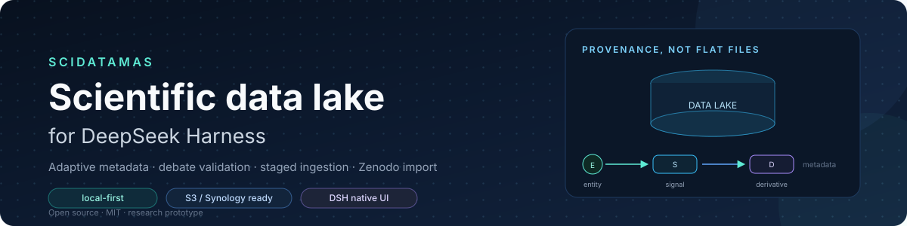
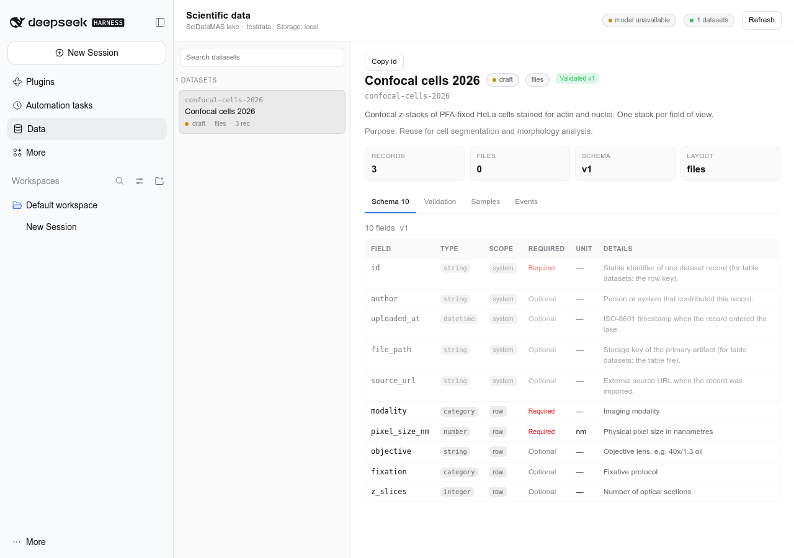
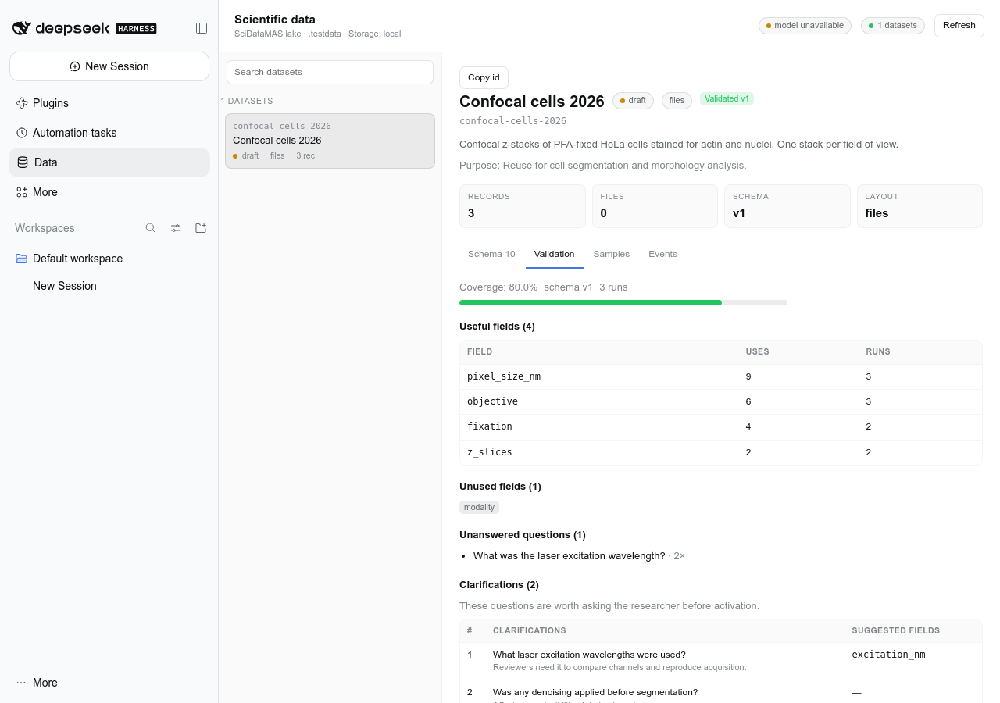
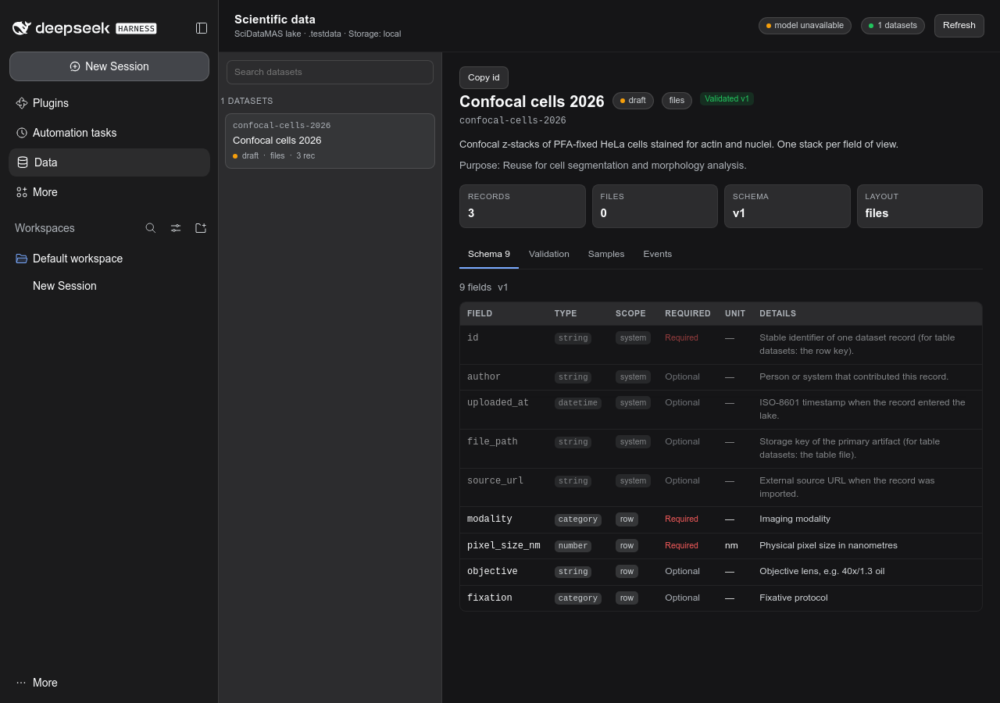
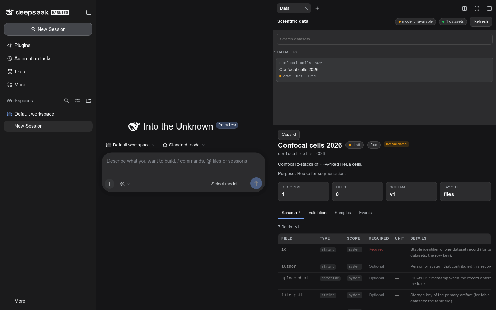
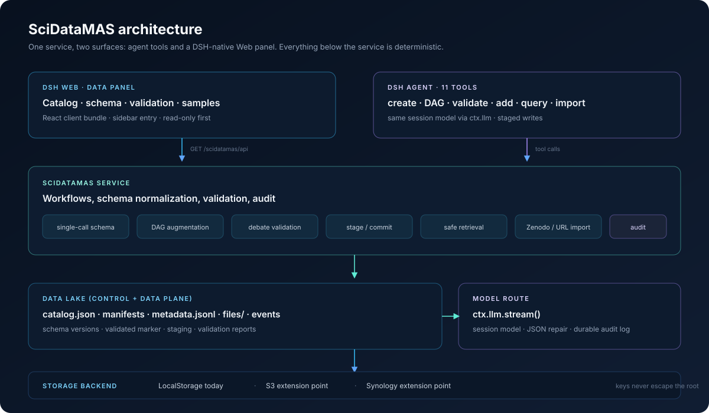

<div align="center">



# SciDataMAS: научное озеро данных для DeepSeek Harness

**Научное озеро данных внутри DSH: адаптивные метаданные, валидация схемы на основе дебатов, загрузка через staging, поиск на естественном языке и нативная веб-панель.**

[English](README.md) · **Русский** · [中文](README.zh.md)

[](CHANGELOG.md)
[](LICENSE)
[](https://github.com/deepseek-ai/deepseek-harness)
[](test/)
[](docs/USER-TESTING.md)
[](#documentation)

</div>

---

SciDataMAS превращает сессию DSH в небольшое, аудируемое научное озеро данных. Агент создаёт датасеты со сгенерированными схемами метаданных, валидирует эти схемы через имитацию рецензирования, помещает новые данные в staging перед коммитом, извлекает файлы по запросам на естественном языке и импортирует опубликованные датасеты из Zenodo или по прямой ссылке. То же озеро видно в нативной для DSH панели **Data**.

Это исследовательский прототип, сейчас он находится в стадии **пользовательского тестирования**. Это не промышленная система управления данными, и он не заменяет LIMS, ELN или институциональный репозиторий.

> **Тестируете эту сборку?** Начните с [руководства пользователя](docs/USER-GUIDE.ru.md) и [протокола тестирования](docs/USER-TESTING.ru.md).

> Построен на идеях из серии работ SciDataMAS: организация озера данных на основе происхождения (provenance), генерация метаданных одним вызовом и с дополнением через DAG, а также оценка полноты на основе дебатов ([Biomed-imaging-lab/SciDataMAS](https://github.com/Biomed-imaging-lab/SciDataMAS)).

> **Источник.** Этот каталог — снимок отдельного репозитория плагина
> SciDataMAS, добавленный в общий репозиторий, чтобы один clone (и один QR)
> давал доступ и к коду статьи, и к запускаемому плагину. Upstream:
> [AS2/scidatamas_dsh](https://github.com/AS2/scidatamas_dsh); до публичного
> релиза он может быть приватным. Когда он станет публичным, используйте его
> для звёзд, issue и свежих изменений; этот снимок остаётся публичной
> запускаемой копией. Коммит и дата снимка: [UPSTREAM.md](UPSTREAM.md).

## Зачем

Научные датасеты обычно хранятся как файлы с коротким README. Метаданные, которые делают их пригодными для повторного использования, — подготовка образцов, параметры съёмки, единицы измерения, производные артефакты, лицензирование, — отсутствуют, противоречат друг другу или их невозможно добавить задним числом. SciDataMAS делает схему метаданных полноправным объектом и сохраняет каждое изменение аудируемым:

- **Адаптивные схемы** вместо одного фиксированного шаблона для всех экспериментов.
- **Расширенный режим с учётом происхождения (provenance)** для многошаговых лабораторных пайплайнов.
- **Валидация через дебаты**, которая задаёт те вопросы, какие задали бы реальные пользователи данных, а затем вскрывает пробелы.
- **Загрузка с участием человека (human-in-the-loop)**, где недостающие поля блокируют коммит, а не заполняются догадками.
- **Локальное хранение как основа** за швом (seam), который может вырасти в бэкенды S3 и Synology.

## Что вы получаете

| Действие | Инструмент | Что делает |
|---|---|---|
| Создать датасет с компактной схемой | `scidatamas_create_dataset` | Один вызов модели генерирует поля метаданных по описанию и просмотренным примерам файлов. Зарезервированные поля `id`, `author`, `uploaded_at`, `file_path`, `source_url` добавляются автоматически. |
| Создать датасет с расширенными метаданными | `scidatamas_create_dataset_dag` | Проектирует DAG происхождения эксперимента (`entity` / `signal` / `derivative`), проверяет его топологию, генерирует поля для каждого узла и объединяет их в одну плоскую схему. |
| Проверить схему | `scidatamas_validate_schema` | По умолчанию три независимых прогона дебатов: сценарий → роли рецензентов → вопросы → ответы владельца → полезные поля, вопросы без ответа и уточнения. |
| Уточнить и активировать | `scidatamas_update_dataset` | Уточнить описание/назначение, добавить поля, изменить статус. Изменение схемы сбрасывает отметку о валидации. |
| Добавить данные по тексту и раскладке | `scidatamas_add_data` + `scidatamas_commit_add` | Просматривает файлы, заполняет метаданные, помещает предложение в staging; коммитит только после того, как обязательные поля заполнены. |
| Найти данные по описанию | `scidatamas_get_data` | Выбирает датасет, строит безопасный JSON-фильтр, возвращает строки метаданных и разрешённые пути к файлам. SQL не выполняется. |
| Импортировать из внешнего источника | `scidatamas_import_external` | Запись/DOI Zenodo или прямая ссылка: анализ, скачивание в staging, просмотр, создание/аннотирование датасета, сопоставление метаданных записи и коммит. |
| Просмотреть озеро | Веб-панель **Data** | Нативный для DSH пункт боковой панели с каталогом, схемой, валидацией, образцами, содержимым метаданных, событиями и ссылками на артефакты. В этой версии доступен только для чтения. |
| Диагностика | `scidatamas_status`, `scidatamas_list_datasets`, `scidatamas_inspect_dataset` | Корень хранилища, доступность модели, перечень датасетов и подробности по каждому датасету. |

Плагин также добавляет раздел SciDataMAS в системный промпт агента, чтобы модель соблюдала дисциплину staging и валидации, а не угадывала.

## Скриншоты

<p align="center">
  
  
</p>

<p align="center">
  
</p>

<p align="center"><sub>Панель следует токенам темы DSH, включая системную тёмную тему.</sub></p>

<p align="center">
  
</p>

<p align="center"><sub>Чат и Data рядом. Нажмите <strong>Открыть рядом с чатом</strong> в шапке панели Data — она закрепится в правом sidebar.</sub></p>

Панель **Data** — часть веб-интерфейса DSH (DSH Web GUI), а не отдельное окно. Она использует тот же профиль, то же озеро и ту же аутентификацию владельца, что и остальной интерфейс. Кнопка **Открыть рядом с чатом** возвращает основную колонку к диалогу и открывает ту же панель в правом sidebar, так что чат и данные видны одновременно.

## Архитектура



Две поверхности используют один сервис:

- **Инструменты агента** — 11 инструментов, доступных модели, для создания, валидации, загрузки, поиска и импорта.
- **Веб-панель** — клиентский бандл React, зарегистрированный в слотах DSH `sidebar.panellist` и `main`; обращается к HTTP API, доступному только для чтения.

Ниже сервиса всё детерминировано: нормализация схемы, валидация DAG, коммиты из staging, безопасные JSON-фильтры, удержание путей в границах (path containment), лимиты и журналы аудита. Модель используется там, где нужно семантическое суждение, а не для записи.

Полное описание архитектуры и точки расширения — в [docs/ARCHITECTURE.md](docs/ARCHITECTURE.md).

## Быстрый старт

### Требования

- DeepSeek Harness `0.2.2-rc.1` (или совместимая версия `0.2.x`).
- Node.js 20+.
- Настроенный маршрут модели в DSH (плагин использует модель сессии через `ctx.llm`).
- Необязательно: `pnpm`, если вы устанавливаете через менеджер плагинов.

### Установка в виде bundle

```bash
dsh plugin --profile web add file:$PWD
```

### Ручная установка (без шага сборки)

Пакет — обычный ESM, а клиентский бандл уже написан, поэтому сборка не нужна. Сделайте пакет видимым для профиля и добавьте одну строку:

```bash
mkdir -p "$DSH_HOME/profiles/web/node_modules"
ln -sfn "$PWD" \
  "$DSH_HOME/profiles/web/node_modules/scidatamas-dsh-plugin"
```

```yaml
# $DSH_HOME/profiles/web/cordis.patch.yml
- insert:
    - id: scidatamas
      name: scidatamas-dsh-plugin
      config:
        root: /home/alex/data/scidatamas
```

Если `dsh` нет в PATH (часто при запуске через npx/desktop) или нет `pnpm`, используйте [scripts/install-local.sh](scripts/install-local.sh): скрипт создаёт симлинк, аккуратно правит патч профиля и создаёт корень озера.

Перезапустите профиль и попросите агента выполнить `scidatamas_status`. В боковой панели появится пункт **Data**.

### Минимальная конфигурация

```yaml
- id: scidatamas
  config:
    root: /home/alex/data/scidatamas
    author: A. Sachuk
    # provider/model are optional: by default the session model is used
    maxSchemaFields: 200
    maxDagNodes: 24
    debateRuns: 3
    maxFileBytes: 536870912
    maxDownloadBytes: 2147483648
    allowNetwork: true
    allowPrivateHosts: false
    logLlmCalls: true
    storageDriver: local
```

Корень озера может быть абсолютным или относительным рабочего каталога процесса. Для реальных данных используйте отдельный каталог вне репозитория.

### Первые пять минут

1. **Создайте черновик**

   > Создай датасет `confocal_cells_2026` из `/data/exp1`. Описание: конфокальные z-стеки клеток HeLa, фиксированных PFA, 40×, предназначенные для сегментации. Используй компактную схему и покажи результат.

2. **Проверьте схему**

   > Посмотри `confocal_cells_2026` и объясни, для чего нужно каждое поле.

3. **Валидируйте её**

   > Запусти валидацию с тремя прогонами дебатов и перечисли вопросы, на которые схема не может ответить.

4. **Уточните и активируйте**

   > Добавь `pixel_size_nm`, `objective` и `fixation`, затем установи статус active.

5. **Добавьте данные**

   > Добавь `/data/exp2`, но покажи метаданные в staging перед коммитом. Учти: 4% PFA, 40×/1.3 oil, размер пикселя 100 нм.

6. **Закоммитьте после проверки**

   > Закоммить staging с этими значениями. Оставь датасет активным.

7. **Найдите данные**

   > Найди все стеки с размером пикселя меньше 150 нм и покажи пути к файлам.

8. **Импортируйте из Zenodo**

   > Проанализируй запись Zenodo 5512749. Затем импортируй только `**/*.tif`, не более 20 файлов.

## Как это работает

### Схема за один вызов

Один вызов модели получает описание, назначение и досье просмотренных файлов: форматы, размеры, размерности изображений, заголовки таблиц, структуру JSON и фрагменты текста. Он возвращает компактную схему. Результат нормализуется: имена в snake_case, допустимые типы, удаление дублей полей, лимит числа полей и зарезервированные организационные поля.

### Схема с дополнением через DAG

Для многошаговых экспериментов плагин сначала проектирует DAG происхождения:

- `entity` — физический объект или образец;
- `signal` — цифровые данные, полученные с сущности;
- `derivative` — цифровые данные, вычисленные из сигналов или других производных;
- рёбра: `preparation` (entity → entity), `capture` (entity → signal), `program` (signal/derivative → derivative).

DAG проверяется на уникальность идентификаторов, допустимость переходов, ацикличность и лимит числа узлов. Затем поля генерируются для каждого узла и объединяются, с добавлением `node_id` / `node_description`. Получается больше полей, чем в плоской схеме, и это лучше подходит для автоматического аннотирования; но полей получается больше, чем нужно для любого повторного использования.

### Валидация через дебаты

Каждый прогон придумывает конкретный эксперимент по описанию и назначению, создаёт независимые роли рецензентов, даёт им задать вопросы владельцу и проверяет, на какие вопросы способна ответить именно эта схема. Поля, отвечающие на вопросы, получают описание того, для чего они нужны; вопросы без ответа становятся уточнениями и предложенными полями. Схема **не** меняется автоматически — что добавить, решает исследователь. Отчёт сохраняется в `datasets/<id>/validation/latest.json`.

### Загрузка через staging

Добавление данных состоит из двух фаз:

1. **Stage** — просмотреть каждый файл, заполнить схему по данным, извлечённым из файлов, и заметке исследователя, явные значения применить последними. Если обязательные поля отсутствуют, объект staging возвращается и файлы не копируются.
2. **Commit** — строгая валидация каждой записи, затем копирование артефактов и запись метаданных. Одна невалидная запись отменяет весь коммит.

Именно это делает безопасной ситуацию «агент не смог что-то аннотировать, и пользователь уточняет текстом»: уточнение становится переопределением у объекта в staging, а не молчаливой догадкой в озере.

### Поиск данных

Планировщик выбирает датасет и формирует JSON-фильтр, например:

```json
{"and": [
  {"field": "modality", "op": "eq", "value": "confocal"},
  {"field": "pixel_size_nm", "op": "lt", "value": 150}
]}
```

Поддерживаемые операторы: `eq`, `ne`, `gt`, `gte`, `lt`, `lte`, `in`, `contains`, `starts_with`, `ends_with`, `exists`, `between`, `and`, `or`, `not`. SQL не генерируется и не выполняется. Лексический fallback сохраняет поиск работоспособным, если план модели не удался.

### Табличные данные

При `layout: "table"` таблица остаётся каноническим артефактом; схема описывает столбцы, а метаданные уровня строк — это sidecar с ключом по ключу строки. `get_data` объединяет столбцы таблицы и строки sidecar. Это избавляет от дублирования CSV в виде JSON-блоба и сохраняет работу фильтров на обоих уровнях. Добавление **новых строк** в существующую таблицу пока не поддерживается — текущая версия аннотирует существующие строки.

### Внешний импорт

Записи Zenodo читаются через API (`/api/records/<id>`); байты файлов попадают в `_imports/<id>`, просматриваются и только затем становятся датасетом. Метаданные записи (DOI, лицензия, авторы, дата публикации) сопоставляются со схемой, а исходный URL сохраняется в каждой записи. Прямые HTTP(S)-ссылки на файлы проходят тот же конвейер staging. Приватные хосты блокируются, если не задано `allowPrivateHosts: true`.

<a id="documentation"></a>
## Документация

| Документ | English | Русский | 中文 |
|---|---|---|---|
| Руководство пользователя | [USER-GUIDE.md](docs/USER-GUIDE.md) | [USER-GUIDE.ru.md](docs/USER-GUIDE.ru.md) | [USER-GUIDE.zh.md](docs/USER-GUIDE.zh.md) |
| Протокол пользовательского тестирования | [USER-TESTING.md](docs/USER-TESTING.md) | [USER-TESTING.ru.md](docs/USER-TESTING.ru.md) | [USER-TESTING.zh.md](docs/USER-TESTING.zh.md) |
| Справочник по инструментам | [TOOLS.md](docs/TOOLS.md) | [TOOLS.ru.md](docs/TOOLS.ru.md) | — |
| Архитектура | [ARCHITECTURE.md](docs/ARCHITECTURE.md) | [ARCHITECTURE.ru.md](docs/ARCHITECTURE.ru.md) | — |
| Скрипт демонстрации для конференции | [DEMO.md](docs/DEMO.md) | [DEMO.ru.md](docs/DEMO.ru.md) | — |
| Глоссарий (EN/RU/ZH) | [GLOSSARY.md](docs/GLOSSARY.md) | — | — |
| Этот README | [README.md](README.md) | [README.ru.md](README.ru.md) | [README.zh.md](README.zh.md) |

## Статус и планы

**Текущий статус: пользовательское тестирование.** Версия **0.1.0** следует [семантическому версионированию](https://semver.org/); см. [CHANGELOG.md](CHANGELOG.md). Панель доступна только для чтения; запись идёт через инструменты агента, где принудительно применяются staging и аудит.

Ближайшие планы:

1. Бэкенды хранилища S3 и Synology + кэш материализации для удалённых артефактов.
2. Действия записи в панели (активация, редактирование описания/схемы, запуск дебатов, коммит staging).
3. Добавление новых строк для табличных датасетов.
4. Просмотр Parquet/Excel/HDF5.
5. Согласование схем между датасетами (top-k поиск + LLM-судья, как в статье).
6. Транзакционный коммит (каталог staging → атомарное переименование).

Известные ограничения: панель только для чтения, нет Parquet/Excel, нет новых строк в таблицах, нет возобновляемых импортов, нет межпроцессной блокировки каталога, а удалённое хранилище — это точка расширения, а не работающий бэкенд.

## Исследование

SciDataMAS — исследовательский прототип. Дизайн следует двум линиям работ:

- SciDataMAS: мультиагентная система для управления научными данными на основе LLM (студенческий abstract AAAI-26) — организация озера на основе происхождения, адаптируемая таксономия метаданных, сценарии создания / вставки / поиска датасетов.
- Курирование метаданных на основе LLM для науки, готовой к ИИ, — генерация за один вызов против генерации с дополнением через DAG, оценка полноты на основе дебатов и контекст узла для полей метаданных.

Если вы используете этот прототип в академической работе, ссылайтесь на проект через [CITATION.cff](CITATION.cff) и исходный репозиторий SciDataMAS. Реализация здесь — не дословный порт Python-прототипа: инструменты DSH предпочитают явные этапы, детерминированную валидацию и след аудита, а LLM отводится семантическая работа.

## Участие и обратная связь

Эта сборка готовится к демонстрации на конференции и раунду пользовательского тестирования. Обратная связь особенно полезна в таком виде:

- конкретная задача, которую вы попробовали;
- что вы ожидали;
- что произошло (скриншот или вывод инструмента);
- доверили бы вы результат в собственных исследованиях.

Протокол и шаблон отчёта об ошибке — в [docs/USER-TESTING.md](docs/USER-TESTING.md).

## Лицензия

MIT — см. [LICENSE](LICENSE).
