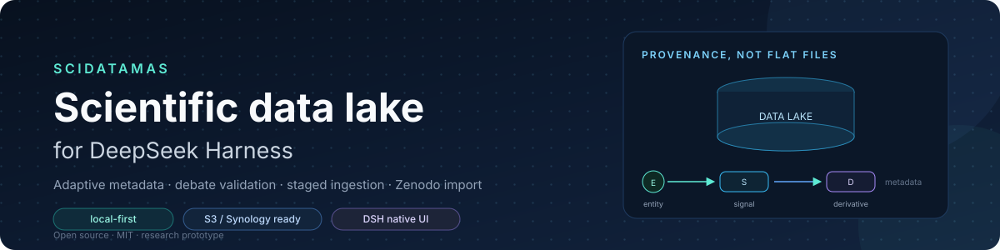
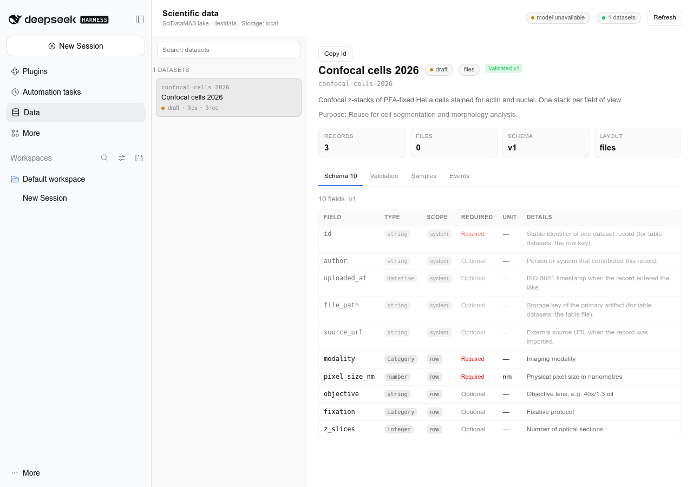
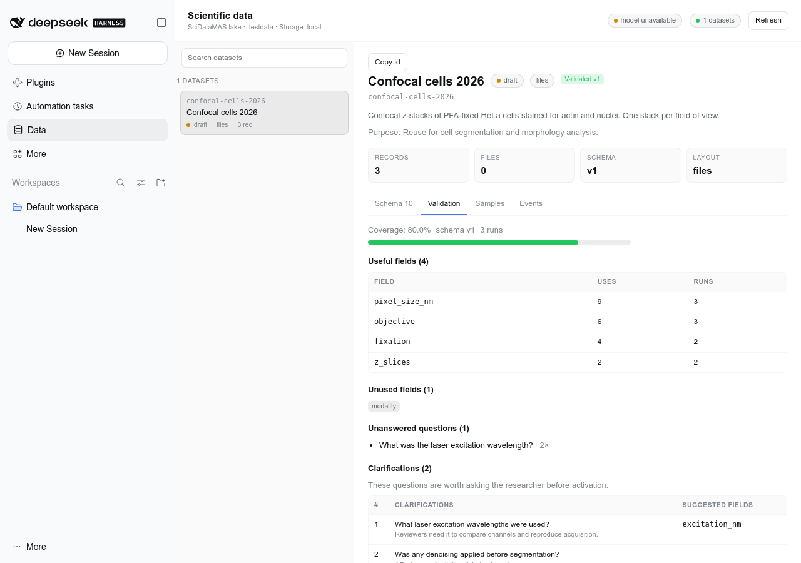
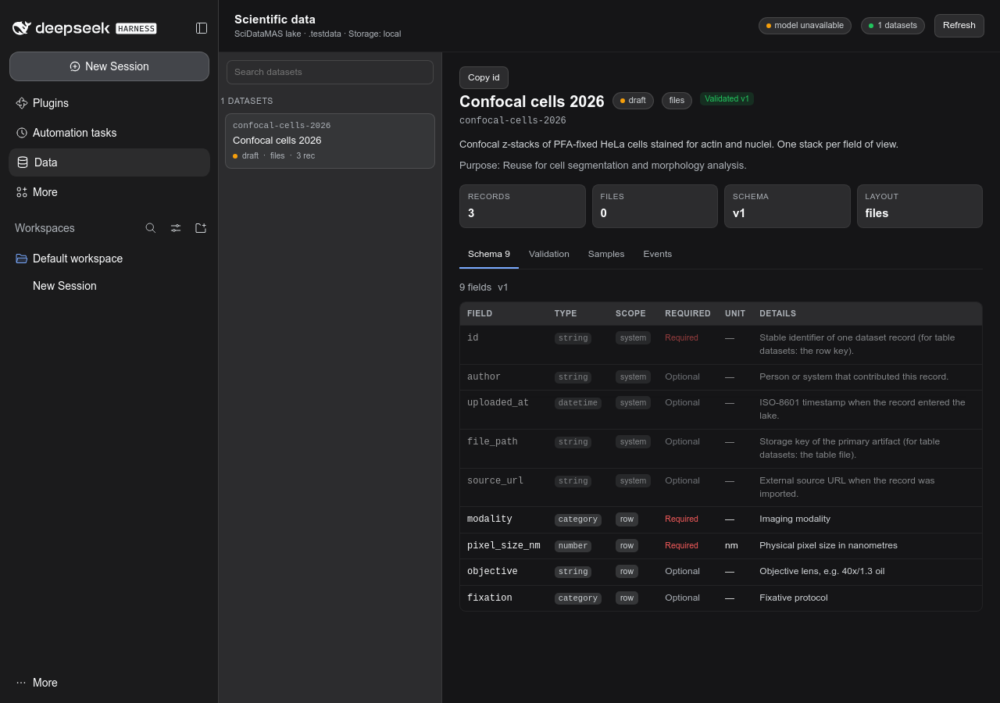
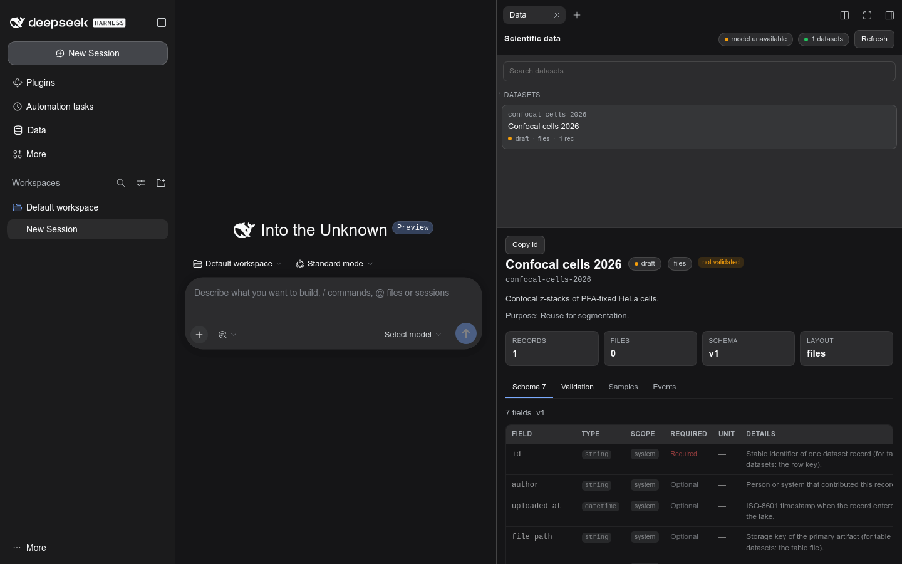
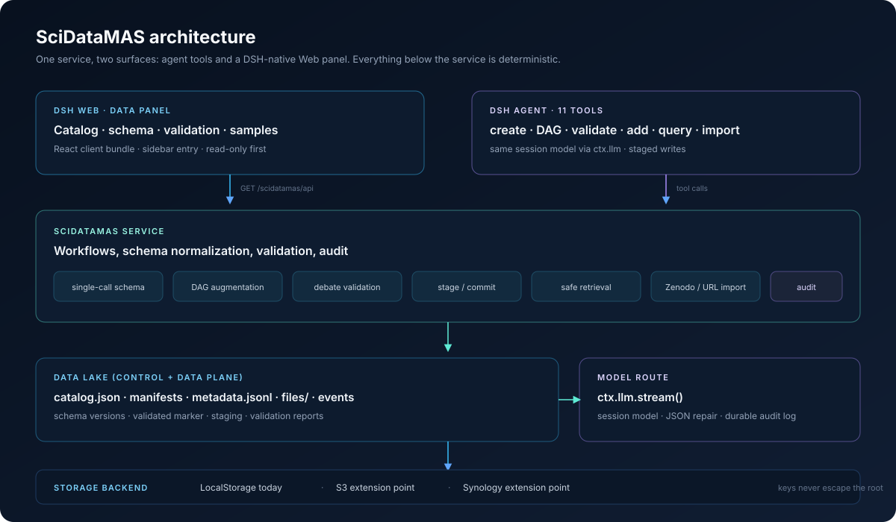

<div align="center">



# SciDataMAS：面向 DeepSeek Harness 的科学数据湖

**DSH 中的科学数据湖：自适应元数据、基于辩论的模式验证、暂存式接入、自然语言检索，以及原生 Web 面板。**

[English](README.md) · [Русский](README.ru.md) · **中文**

[](CHANGELOG.md)
[](LICENSE)
[](https://github.com/deepseek-ai/deepseek-harness)
[](test/)
[](docs/USER-TESTING.md)
[](#documentation)

</div>

---

SciDataMAS 能把一个 DSH 会话变成一个小巧、可审计的科学数据湖。智能体会用生成的元数据模式创建数据集，通过模拟同行评审来验证这些模式，在提交前先暂存新数据，通过自然语言查询检索文件，并从 Zenodo 或直链 URL 导入已发布的数据集。同一个数据湖也能在 DSH 原生的 **Data** 面板中查看。

本项目是一个研究原型，目前处于**用户测试**阶段。它不是生产级的数据管理系统，也不能替代 LIMS、ELN 或机构仓储。

> **正在测试此构建？** 请先阅读[用户指南](docs/USER-GUIDE.zh.md)和[用户测试方案](docs/USER-TESTING.zh.md)。

> 基于 SciDataMAS 系列工作的思想构建：基于溯源的数据湖组织、单次调用与 DAG 增强的元数据生成，以及辩论驱动的完整性评估（[Biomed-imaging-lab/SciDataMAS](https://github.com/Biomed-imaging-lab/SciDataMAS)）。

## 动机

科学数据集通常以文件形式保存，外加一份简短的 README。而让它们可被复用的那一层元数据——样品制备、采集参数、单位、衍生产物、许可条款——往往缺失、前后不一致，或者无法事后补齐。SciDataMAS 把元数据模式作为一等对象，并让每一次变更都可审计：

- **自适应模式**，而不是为每个实验套用同一个固定模板。
- **支持溯源的富模式**，适用于多步骤实验室流程。
- **辩论式验证**：提出真实复用者会问的问题，然后暴露其中的缺口。
- **人在回路的接入流程**：缺失字段会阻止提交，而不是被猜测填充。
- **本地优先存储**，预留了可扩展到 S3 与 Synology 后端的接口层。

## 功能一览

| 操作 | 工具 | 作用 |
|---|---|---|
| 用精简模式创建数据集 | `scidatamas_create_dataset` | 一次模型调用即可根据描述和已检查的示例文件生成元数据字段。保留字段 `id`、`author`、`uploaded_at`、`file_path`、`source_url` 会自动添加。 |
| 创建带丰富元数据的数据集 | `scidatamas_create_dataset_dag` | 设计实验溯源 DAG（`entity` / `signal` / `derivative`），校验其拓扑结构，为每个节点生成字段，再合并为一个扁平模式。 |
| 验证模式 | `scidatamas_validate_schema` | 默认执行三次独立的辩论：场景 → 评审角色 → 提问 → 所有者回答 → 有用字段、未解答的问题与待澄清问题。 |
| 完善并启用 | `scidatamas_update_dataset` | 澄清描述与用途、添加字段、变更状态。模式一旦变更，已验证标记即失效。 |
| 通过文本与布局添加数据 | `scidatamas_add_data` + `scidatamas_commit_add` | 检查文件、填写元数据并暂存该提案；只有在必填字段齐备后才会提交。 |
| 按描述检索数据 | `scidatamas_get_data` | 选定一个数据集，构建安全的 JSON 过滤器，返回元数据行与解析后的文件路径。不会执行任何 SQL。 |
| 从外部来源导入 | `scidatamas_import_external` | Zenodo 记录/DOI 或直链 URL：分析、下载到暂存区、检查、创建或标注数据集、映射记录元数据，然后提交。 |
| 浏览数据湖 | **Data** Web 面板 | DSH 原生的侧边栏入口，包含目录、模式、验证、样本、元数据内容、事件与产物链接。本版本为只读。 |
| 诊断 | `scidatamas_status`、`scidatamas_list_datasets`、`scidatamas_inspect_dataset` | 存储根目录、模型可用性、数据集清单，以及单个数据集的详细信息。 |

插件还会在智能体的系统提示词中加入一个 SciDataMAS 小节，使模型遵循暂存与验证的规范，而不是凭空猜测。

## 截图

<p align="center">
  
  
</p>

<p align="center">
  
</p>

<p align="center"><sub>面板遵循 DSH 主题令牌，包括系统深色模式。</sub></p>

<p align="center">
  
</p>

<p align="center"><sub>聊天与 Data 并排。在 Data 面板顶部点击<strong>在聊天旁打开</strong>，面板会停靠到右侧边栏。</sub></p>

**Data** 面板是 DSH Web GUI 的一部分，而不是独立窗口。它与其他界面共用同一个 profile、同一个数据湖和同一套所有者认证。 **在聊天旁打开**按钮会把主区域切回对话，并在右侧边栏打开同一面板，让聊天和数据同时可见。

## 架构



两个界面共用一个服务：

- **智能体工具**——11 个面向模型的工具，覆盖创建、验证、接入、检索与导入。
- **Web 面板**——一个注册到 DSH `sidebar.panellist` 与 `main` 插槽中的 React 客户端 bundle；它通过只读 HTTP API 通信。

在服务之下，一切都是确定性的：模式规范化、DAG 验证、暂存式提交、安全的 JSON 过滤器、路径包含检查、限额与审计日志。模型只用于需要语义判断的地方，而不用于写入。

完整设计与扩展点请参阅 [docs/ARCHITECTURE.md](docs/ARCHITECTURE.md)。

## 快速开始

### 环境要求

- DeepSeek Harness `0.2.2-rc.1`（或兼容的 `0.2.x`）。
- Node.js 20+。
- 已配置的 DSH 模型路由（插件通过 `ctx.llm` 使用会话模型）。
- 可选：若通过插件管理器安装，则需要 `pnpm`。

### 以 bundle 形式安装

```bash
dsh plugin --profile web add file:$PWD
```

### 手动安装（无需构建步骤）

该包是纯 ESM，客户端 bundle 为手写产物，因此无需构建。让 profile 能够发现该包，并添加一行配置：

```bash
mkdir -p "$DSH_HOME/profiles/web/node_modules"
ln -sfn "$PWD" \
  "$DSH_HOME/profiles/web/node_modules/scidatamas-dsh-plugin"
```

```yaml
# $DSH_HOME/profiles/web/cordis.patch.yml
- insert:
    - id: scidatamas
      name: scidatamas-dsh-plugin
      config:
        root: /home/alex/data/scidatamas
```

如果 PATH 中没有 `dsh`（npx/桌面启动时很常见）或没有 `pnpm`，请使用 [scripts/install-local.sh](scripts/install-local.sh)：它会创建符号链接、安全修改配置补丁并创建数据湖根目录。

重启该 profile，然后让智能体运行 `scidatamas_status`。侧边栏中会出现 **Data** 入口。

### 最小配置

```yaml
- id: scidatamas
  config:
    root: /home/alex/data/scidatamas
    author: A. Sachuk
    # provider/model are optional: by default the session model is used
    maxSchemaFields: 200
    maxDagNodes: 24
    debateRuns: 3
    maxFileBytes: 536870912
    maxDownloadBytes: 2147483648
    allowNetwork: true
    allowPrivateHosts: false
    logLlmCalls: true
    storageDriver: local
```

数据湖根目录可以是绝对路径，也可以相对于进程的工作目录。存放真实数据时，请使用仓库之外的专用目录。

### 最初的五分钟

1. **创建草稿**

   > 从 `/data/exp1` 创建一个数据集 `confocal_cells_2026`。描述：PFA 固定的 HeLa 细胞共聚焦 z 轴序列，40×，拟用于分割。使用精简模式，并把结果展示给我。

2. **查看模式**

   > 查看 `confocal_cells_2026`，并说明每个字段的用途。

3. **验证它**

   > 运行三轮辩论式验证，并列出该模式无法回答的问题。

4. **完善并启用**

   > 添加 `pixel_size_nm`、`objective` 和 `fixation`；然后把状态设为 active。

5. **添加数据**

   > 添加 `/data/exp2`，但在提交前先把暂存的元数据展示给我。备注：4% PFA，40×/1.3 油镜，像素尺寸 100 nm。

6. **审阅后再提交**

   > 用这些值提交该暂存。保持数据集为 active 状态。

7. **检索**

   > 找出所有像素尺寸小于 150 nm 的序列，并显示文件路径。

8. **从 Zenodo 导入**

   > 分析 Zenodo 记录 5512749。然后只导入 `**/*.tif`，最多 20 个文件。

## 工作原理

### 单次调用生成模式

一次模型调用会收到描述、用途，以及一份已检查文件的清单：格式、大小、图像尺寸、表头、JSON 结构与文本摘录。它返回一个精简模式。结果会经过规范化：snake_case 命名、允许的类型、字段去重、字段数量上限，以及保留的组织性字段。

### DAG 增强模式

对于多步骤实验，插件会先设计一个溯源 DAG：

- `entity`——实体，即物理对象或样本；
- `signal`——信号，即从实体采集的数字数据；
- `derivative`——派生数据，即由信号或其他派生产物计算得到的数字数据；
- 边：`preparation`（entity → entity）、`capture`（entity → signal）、`program`（signal/derivative → derivative）。

DAG 会检查 id 唯一性、合法转换、无环性以及节点数量上限。随后按节点生成字段并合并，同时附加 `node_id` / `node_description`。相比扁平模式，这会生成更多字段，也更适合自动化标注；但它生成的字段同样会超出每次复用实际所需。

### 辩论式验证

每一轮都会根据描述与用途构想一个具体实验，创建相互独立的评审角色，让它们向数据所有者提问，并检查当前模式究竟能回答哪些问题。能回答问题的字段会获得一项用途；未能回答的问题则转为待澄清问题和建议字段。模式**不会**被自动修改——由研究者决定添加什么。报告保存在 `datasets/<id>/validation/latest.json`。

### 暂存式接入

添加数据分为两个阶段：

1. **暂存**——检查每个文件，依据证据与研究者的备注填写模式，最后再应用显式指定的值。若有必填字段缺失，则返回暂存结果，且不会复制任何文件。
2. **提交**——对每条记录做严格验证，然后复制产物并写入元数据。只要有一条记录无效，整个提交就会中止。

这正是“智能体无法标注某项内容，于是用户在文本中补充说明”能够安全进行的原因：澄清内容会成为暂存对象上的覆盖值，而不是数据湖中一次无声的猜测。

### 检索

规划器会选定一个数据集并输出 JSON 过滤器，例如：

```json
{"and": [
  {"field": "modality", "op": "eq", "value": "confocal"},
  {"field": "pixel_size_nm", "op": "lt", "value": 150}
]}
```

支持的运算符：`eq`、`ne`、`gt`、`gte`、`lt`、`lte`、`in`、`contains`、`starts_with`、`ends_with`、`exists`、`between`、`and`、`or`、`not`。不会生成或执行任何 SQL。若模型规划失败，词法回退机制仍能保证检索可用。

### 表格数据

对于 `layout: "table"`，表格仍是规范产物；模式描述各列，而行级元数据是以行键为索引的附属元数据（sidecar）。`get_data` 会合并表列与附属元数据行。这样可避免把 CSV 复制成一份 JSON blob，并让过滤器在两层上都生效。目前尚不支持向已有表格添加**新行**——当前版本只对已有行进行标注。

### 外部导入

Zenodo 记录通过 API（`/api/records/<id>`）读取；文件字节先写入 `_imports/<id>`，经过检查后才成为数据集。记录的元数据（DOI、许可、创建者、发布日期）会映射到模式上，且每条记录都会保存来源 URL。直接的 HTTP(S) 文件 URL 走同样的暂存流程。除非设置 `allowPrivateHosts: true`，否则私有主机会被阻止。

<a id="documentation"></a>
## 文档

| 文档 | English | Русский | 中文 |
|---|---|---|---|
| 用户指南 | [USER-GUIDE.md](docs/USER-GUIDE.md) | [USER-GUIDE.ru.md](docs/USER-GUIDE.ru.md) | [USER-GUIDE.zh.md](docs/USER-GUIDE.zh.md) |
| 用户测试规程 | [USER-TESTING.md](docs/USER-TESTING.md) | [USER-TESTING.ru.md](docs/USER-TESTING.ru.md) | [USER-TESTING.zh.md](docs/USER-TESTING.zh.md) |
| 工具参考 | [TOOLS.md](docs/TOOLS.md) | [TOOLS.ru.md](docs/TOOLS.ru.md) | — |
| 架构 | [ARCHITECTURE.md](docs/ARCHITECTURE.md) | [ARCHITECTURE.ru.md](docs/ARCHITECTURE.ru.md) | — |
| 会议演示脚本 | [DEMO.md](docs/DEMO.md) | [DEMO.ru.md](docs/DEMO.ru.md) | — |
| 术语表（EN/RU/ZH） | [GLOSSARY.md](docs/GLOSSARY.md) | — | — |
| 本文 README | [README.md](README.md) | [README.ru.md](README.ru.md) | [README.zh.md](README.zh.md) |

## 状态与路线图

**当前状态：用户测试中。** 版本 **0.1.0** 遵循[语义化版本](https://semver.org/)；参见 [CHANGELOG.md](CHANGELOG.md)。 面板为只读；写操作通过智能体工具完成，暂存与审计正是在这些工具中强制执行。

近期计划：

1. S3 与 Synology 存储后端，以及面向远程产物的物化缓存。
2. 面板中的写操作（启用、编辑描述/模式、运行辩论、提交暂存）。
3. 表格数据集的新行追加。
4. Parquet/Excel/HDF5 检查。
5. 数据集之间的模式协调（top-k 检索 + LLM 评判，与论文中一致）。
6. 事务性提交（暂存目录 → 原子重命名）。

已知限制：面板只读、不支持 Parquet/Excel、不能新增表格行、导入不可断点续传、没有跨进程的目录锁，远程存储目前只是扩展点而非可用的后端。

## 研究

SciDataMAS 是一个研究原型。其设计遵循两条工作脉络：

- SciDataMAS：面向科学数据管理的 LLM 驱动多智能体系统（AAAI-26 学生摘要）——基于溯源的数据湖组织、可调整的元数据分类体系，以及数据集创建 / 插入 / 检索工作流。
- 面向 AI 就绪科学的 LLM 元数据整理——单次调用与 DAG 增强生成的对比、辩论驱动的完整性评估，以及元数据字段的节点上下文。

如果你在学术工作中使用此原型，请通过 [CITATION.cff](CITATION.cff) 及原始 SciDataMAS 仓库引用本项目。此处的实现并非对 Python 原型的一对一移植：DSH 工具更倾向于显式阶段、确定性验证与审计轨迹，而 LLM 只留给语义相关的工作。

## 贡献与反馈

当前构建正在为一场会议演示和一轮用户测试做准备。最有价值的反馈形式如下：

- 你尝试过的具体任务；
- 你期望的结果；
- 实际发生的情况（截图或工具输出）；
- 你是否会在自己的研究中信任这一结果。

规程内容与缺陷报告模板请参阅 [docs/USER-TESTING.md](docs/USER-TESTING.md)。

## 许可证

MIT——详见 [LICENSE](LICENSE)。
